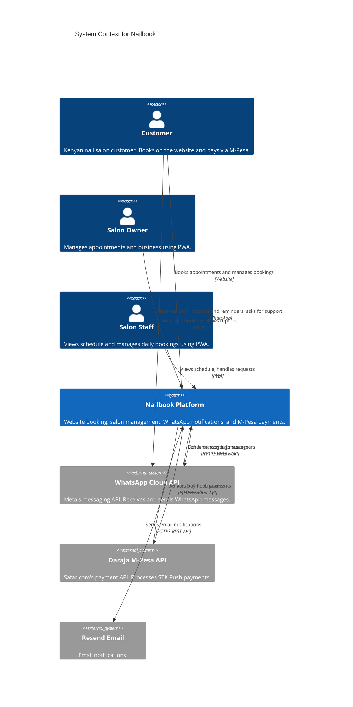
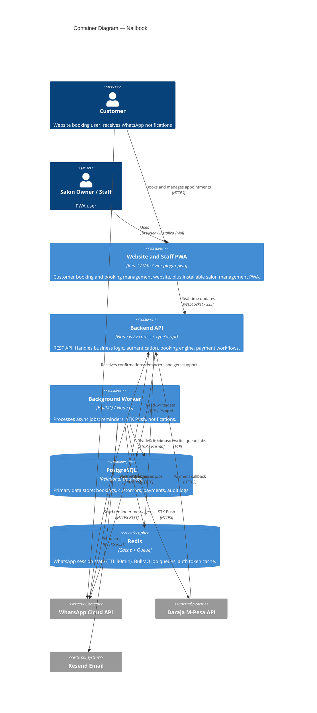
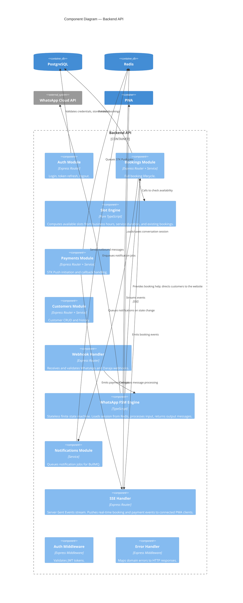
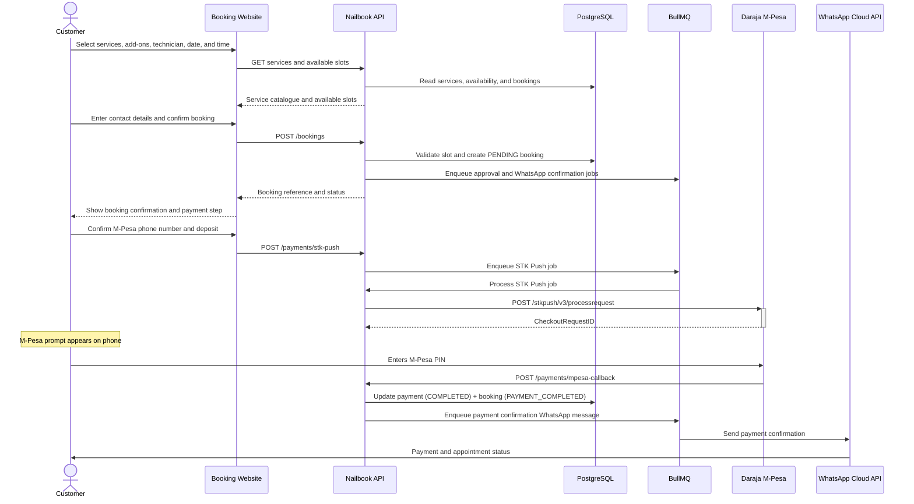
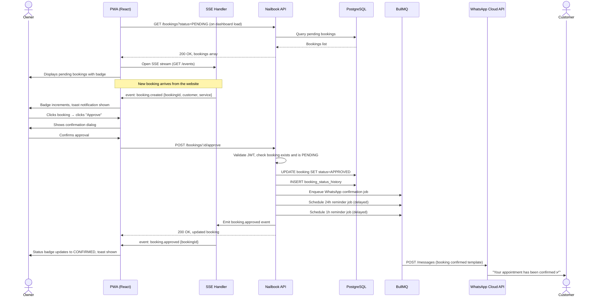
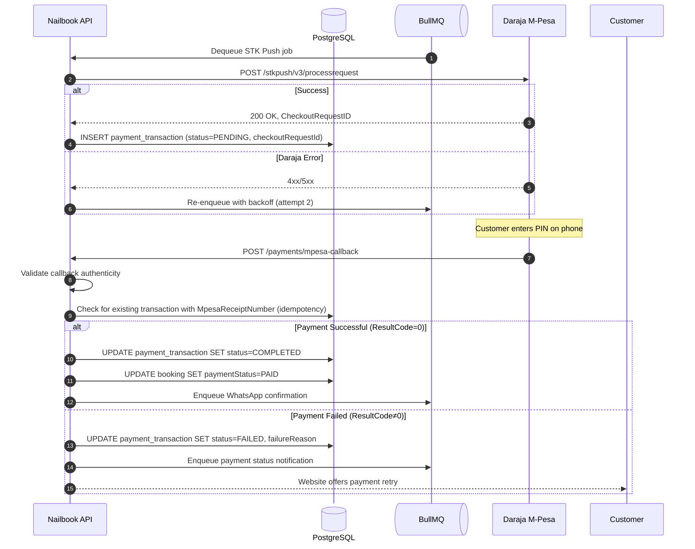
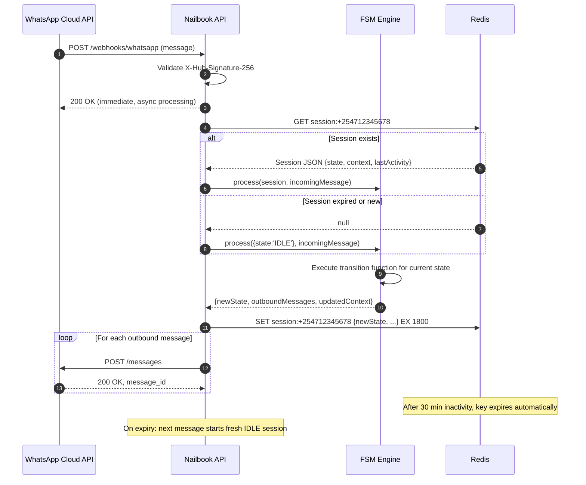

# Architecture — Nailbook

**Version:** 1.1

---

## C4 Level 1: System Context Diagram

---

## C4 Level 2: Container Diagram

---

## C4 Level 3: Component Diagram — Backend API

---

## Sequence Diagram: Booking Creation (Website)

---

## Sequence Diagram: Booking Approval (PWA)

---

## Sequence Diagram: Payment Processing (STK Push)

---

## Sequence Diagram: WhatsApp Conversation Session Management

> **Redis key format:** `<APP_NAME>:<process>:<store>:<key>`, e.g. `Nailbook:worker:session:254712345678`. The `<APP_NAME>:<process>:` prefix is added automatically by each process's Redis client; the keys shown in the diagram above are the logical `<store>:<key>` part. BullMQ queues use `<APP_NAME>:bull:<queueName>` instead. See `.agents/backend.md`.
